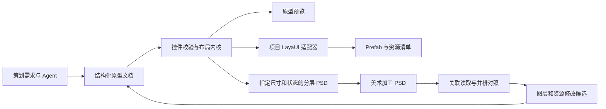

# 原型、LayaUI、Prefab 与 PSD 协作方案

Status: Draft
Date: 2026-11-13
Scope: 基于 xq-client 实际 UI 库设计布局、控件、Prefab 导出、PSD 导出及关联预览。本文描述目标方案，尚未实现；短 ID 的当前实现见 [nanoid-element-ids.md](nanoid-element-ids.md)。

## 1. Context

GameFlow 的方向是让策划和 Agent 编辑同一份结构化游戏 UI 原型，程序与美术基于它交付。用户明确补充：页面可以关联 PSD，在原型旁读取、展示美术稿；节点需要不可变的内置 ID，长度参考 Laya；必须支持已有 Prefab，其中未在原型配置的属性和业务组件需要持续保留。

本次只读调查 `C:/Users/bite/Codetypes/xq-client` 的工作区，参考 HEAD 为 `fb11b09`。源码、真实 Prefab 和工具脚本是方案依据，未修改该项目。`package.json` 标记 LayaAir 3.4.0，项目文件标记 3.4.1，且存在项目引擎目录；适配器必须锁定实际引擎和 UI 库版本，不能只按“Laya 3”推断格式。

## 2. Goals

- 原型保存控件语义、布局意图、稳定身份、资源引用及需求来源。
- 预览与目标 LayaUI 使用一致的布局规则；Prefab 保留布局能力。
- 将指定页面、设计尺寸和状态导出为分层 PSD，交给美术加工。
- 支持关联独立制作或由本工具导出的 PSD，在无限画布中并排预览，之后扩展图层映射及资源回流。
- 重复导出能够追踪同一节点、资源和产物版本，保护业务脚本及人工修改。
- 将已有 Prefab 关联到原型，按明确的节点/属性管理范围更新，保留未接管内容；支持识别双方修改和冲突。
- 支持 PSD 合并工作台：左上/左下展示两个来源的图层树和预览，右侧展示结果树和预览；基于共同版本进行三方比较，逐节点选择采用来源。

## 3. Non-Goals

- 首轮不实现 Photoshop 编辑器、任意 PSD 特效合成器或完整 Laya IDE。
- 原型中的页面跳转不直接生成项目业务逻辑、网络请求或运行时数据绑定。
- PSD 的每个图层不自动变成游戏节点；已有 Prefab 只将受支持的结构/属性投影到原型，完整引擎语义编辑仍由 Laya 工具承担。
- 本次不实现导出器，不安装 PSD 依赖，不向游戏工程写产物。

## 4. Current Behavior and Evidence

调查时 `shared/model.ts` 为 schema v1：页面、扁平节点数组、`parentId`、固定 `frame`、简单样式与内嵌图片。后续原型布局已由 [prototype-ui-layout.md](prototype-ui-layout.md) 落实为 schema v2 的 layout/widget 和 16 种节点，实际基线见 [11-prototype-ui-layout.md](11-prototype-ui-layout.md)。本草案中的完整资源表、组件定义、状态变体、PSD 关联及 Prefab 管线仍属后续工作。

| 已核实的目标能力 | 对设计的影响 |
| --- | --- |
| `layout.ts` 是不依赖 Laya 运行时的轴布局求解；`list-layout.ts` 也是独立计算 | 适合提取为共享布局内核 |
| `UIWidget` 的六项约束使用 `number \| null`，单位为 absolute/percent | `null` 是关闭，0 是有效约束；10 表示 10% |
| 尺寸来源为 explicit/measured/stretch；禁止 `autoSize` | 原型要区分尺寸意图和最终矩形 |
| `UIBox` 提供四边 padding、测量和裁剪；HBox/VBox/Grid 各有冲突约束 | CSS flex/grid 不能直接当作目标语义 |
| `UILabel` 自身绘制，支持普通字体、BitmapFont、MSDF；`text-layout.ts` 注入测量函数 | 文本排版和字体测量需要独立适配 |
| `UIButton extends UIImage`，状态为 normal/selected/pressed/disabled skin | 按钮文字应为子 UILabel，不能假设有 `label` 属性 |
| `UIList` 使用 `cellPrefab`，按条目尺寸、wrapCount、gapX/Y 布局和虚拟化 | 模板、示例数据和运行时实例必须区分 |
| `.lh` 使用 `_$id`、`_$type`、`scriptPath`、`_$child`、`_$comp`；图片可用 `res://UUID` | 需要项目专用序列化和资源解析器 |
| `class-alias.ts` 和保存 hook 支持稳定类名；`.ts.meta` 仍有脚本 UUID | 类别名、节点 ID、脚本 UUID、资源 UUID 各有用途 |
| `engine/types/editor.d.ts` 的 `genShortId()` 默认 8 位，小写字母/数字，首位字母 | 原型按用户新要求使用 8 位 Nano ID、小写字母/数字、首位可为数字；导出需校验目标格式并持久映射 |
| `tools/src/res/sync-assets` 已有客户端/美术同步和 ComponentReflect 映射 | 接入现有流水线，明确每个目录和字段的写入方 |
| `tools/src/res/ui-index` 扫描 resources 下以 UI 开头的 `.lh` 和 `.meta` | 页面资源命名、UUID 唯一性和索引生成需要纳入验收 |

在检查的 `tools`、`assets/plugins`、UI 目录 TypeScript 源码与包配置中，未发现 PSD 读写实现；这不代表外部美术工程没有自己的工具。

## 5. Proposed Behavior

### 5.1 编辑与对照

总览继续使用无限画布。每个页面右侧可以显示关联的 PSD 美术稿卡片，默认等比例、顶端对齐，标题包含文件名、状态和更新信息。页面与美术稿组成对照组，拖动整组保持相对位置；可调整美术稿卡片的相对偏移，不改变页面设计尺寸或控件坐标。

双击页面后进入页面编辑：左侧仍是游戏控件层级，右侧仍是 VS Code 风格悬浮属性面板。增加“原型 / 对照 / 美术稿”视图；对照视图默认并排，后续支持透明叠加、对齐基准和同步缩放。同步缩放只影响视口，不修改任何源文件。

用户通过页面菜单“关联 PSD”选择文件，支持已有 PSD，不要求先由 GameFlow 导出。一个页面可以关联多份 PSD，例如普通/选中状态、横竖屏或不同版本；同一 PSD 可以通过明确选择画板/区域关联多个页面。首版先支持整份 PSD，画板选择后续加入。关联未完成时显示整图，也具有独立价值。

PSD 文件保存后自动检查变化，重新解析并刷新预览；显示加载中、已更新、文件丢失或解析失败。解析失败时如保留上次成功预览，必须标注旧版本。解除关联仅删除引用，不删除 PSD。复制页面生成新的页面和节点 ID；可保留同一 PSD 的只读参考，但不继承已经批准的节点/切图绑定。

美术图层树按需作为“PSD 图层”标签展开，与游戏控件树分开。只有建立映射的节点才支持双向高亮；先提供组名、可见性和边界信息，暂不承诺隐藏图层后仍能精确重合成复杂 PSD。

### 5.2 三类内容的职责

| 内容 | 主要维护内容 | 更新规则 |
| --- | --- | --- |
| 原型文档 | 节点身份、层级、布局、控件语义、状态与资源绑定 | 人工/Agent 通过可撤销文档事务更新 |
| PSD | 美术表现、图层、效果和原始素材 | 美术在 Photoshop 加工；关联预览只读 |
| Prefab | 目标库可加载的完整节点、资源引用、引擎属性及业务组件 | 新建时生成；关联后仅更新原型明确管理的部分，其他内容由项目维护 |

PSD 刷新只更新预览缓存和变化提示。采用新切图、改字体或调整节点位置，是独立的候选修改；确认后才改变原型文档。支持“美术已更新，但原型绑定尚未采用”的明确状态。

### 5.3 已有 Prefab 的关联体验

页面提供“新建 Prefab”“关联已有 Prefab”“查看同步差异”三个入口。也可以从已有 Prefab 建立一个原型页面，仅呈现当前支持的控件和属性，其他节点显示为只读的外部组件/占位节点。原型能用于局部编辑，无需先覆盖目标库的所有属性。

首次关联显示节点对应关系与管理范围，例如“同步布局，skin 和业务组件由 Prefab 管理”。没有历史清单时，关联本身只建立基线，不立即改写文件。已有原型与 Prefab 的差异单独列出，选择要采用的字段后才接管。

属性面板将相关属性组标记为“原型管理”或“Prefab 管理”；后者可以显示读取到的值，并提供打开源 Prefab 的入口。只有能完整支持的属性组才提供接管操作。页面总览显示“已同步 / 原型待同步 / Prefab 已变化 / 存在冲突”，常规同步预览说明将修改和保留的内容。

## 6. Design

### 6.1 主数据和生成路径

Prefab 使用布局意图和解析后的资源引用；PSD 使用指定尺寸下的布局结果。二者共享校验、组件展开、字体度量输入和资源解析，不共用一张扁平截图作为数据源。

### 6.2 不可变节点 ID

1. 新建页面和控件通过 Nano ID `customAlphabet` 使用 8 位 `[a-z0-9]{8}` ID，首位可为数字；生成后立即检查当前文档及本次分配记录，冲突则重新生成，达到上限明确报错。
2. 改名、拖动、缩放、重排、换父级、换 skin、保存、重新打开均保留原 ID。删除再撤销恢复原 ID；复制节点/子树/页面为副本分配新 ID，并重映射内部引用。
3. 用户已授权旧原型 ID 一次性迁移：未带 `elementIdScheme: "nanoid-8"` 的文档在首次编辑器初始化时统一重分配页面/控件 ID 并更新引用；保存标记后不重复。普通解析、序列化不改号；迁移可撤销。详见 [nanoid-element-ids.md](nanoid-element-ids.md)。外部已有 Prefab/PSD 不因本次原型迁移自动改号。
4. ID 是作用域内的身份，不是跨项目全局唯一值。跨文档以 `documentId + pageId + nodeId` 定位；组件实例后续增加实例路径，不能把模板节点与所有实例混为一个对象。
5. 新格式节点可以优先将原型 ID 写为 Laya `_$id`，前提是通过目标格式校验且在产物作用域内唯一。旧 ID、展开产生的辅助节点用持久映射分配目标 ID。`Prefab 资源 UUID + _$id + 实例路径` 是目标端定位依据。
6. PSD 保留原生数字图层 ID，并在 GameFlow 元数据中保存独立的稳定图层 ID；持久清单记录 `原型节点 ID ↔ PSD 文档谱系 + GameFlow 图层 ID/组 ID + 状态`，允许一对多。图层名仅用于显示和搜索，不是主键。
7. PSD 身份管理只依赖元数据：唯一有效 ID 延续原对象，重复 ID 为副本分配新身份，无身份元数据按新对象导入；图层合并结果一律视为新对象，不分析实际图像、不推断或恢复多对一来源。消失的旧 ID 标为美术对象消失及绑定失效，不自动删除原型节点。相同名称、原生 ID 或像素均不能让无元数据层继承旧身份。元数据损坏/版本不支持与没有元数据区别处理；重复项有歧义时依据身份记录解决，不按内容猜测。详细规则见 [PSD 身份管理](psd-three-way-merge.md#611-元数据管理规则2026-11-13-用户确认)。外部 PSD 没有 GameFlow 元数据也能正常关联整图。
8. 对象 ID、文件内容 hash、源文档 revision 分开：对象身份不随内容修改，hash/revision 用于判断产物是否过期。`.meta.uuid` 保持目标资源的 UUID 规范，不能缩为节点短 ID。

### 6.3 文档模型演进

下列结构为完整管线的目标模型，不能视为当前 schema v2 的字段契约。原型布局工作项已用最小的 layout/widget 扩展提供 v2，首次有效编辑在同一可撤销事务升级、保留 ID；资源表/绑定等结构须在后续版本另定迁移方式。

| 结构 | 保存的信息 |
| --- | --- |
| document | documentId、持久 revision、requirements、目标适配 profile、资源表 |
| page | id、名称、设计宽高、页面类型、目标根类、状态集合、PSD 引用 |
| workspace placement | 页面世界位置、美术稿相对位置；与游戏设计尺寸分离 |
| node | id、name、parentId、控件种类、类型化 props、局部几何、布局约束、需求引用 |
| geometry/layout | x/y、宽高 explicit/measured 意图、scale/pivot、六项约束、单位；stretch 从双边约束推导 |
| container layout | free/horizontal/vertical/grid、padding、gap、align、wrapCount、裁剪 |
| assets | 稳定 assetId、项目逻辑路径、来源、纹理尺寸、字体配置和切片信息 |
| component definition | 模板节点树、可覆盖属性；UIList 指向条目模板，示例数据仅供预览 |
| art reference | PSD 引用 ID、逻辑路径、选定画板/区域、版本 hash、对齐变换、节点/图层映射 |
| prefab binding / export manifest | 源 revision/hash、目标 profile 版本、节点/资源 ID 映射、字段与结构管理范围、上次协调的原型/Prefab 基线、产物路径和上次写出 hash |

宽高用 `explicit(value)` 或 `measured` 表达；有双边约束时显示只读的 stretch 来源。布局计算结果包括最终矩形、文字排版与裁剪区域，作为派生数据缓存，不反写成另一套权威坐标。

资源从节点内 base64 逐步迁移到资源表，PSD 本体不嵌入 JSON。可移植引用使用 workspace/project 根标识加相对路径；用户选择的外部目录映射保存在本机设置。预览缩略图可重建；ID/绑定/导出清单是持久协作数据，不能随缓存清理丢失。

### 6.4 布局语义与拖动规则

- 六项约束遵循目标库：位置优先 center、leading、trailing、原位置；双边约束优先决定尺寸。按父内容区和 padding 计算，保持目标取整规则。
- UIBox 的内容测量不能依赖同轴尚未确定的父尺寸；百分比、右/下/居中与父内容测量的循环应给出明确节点诊断。
- HBox 子节点禁止水平相对约束，VBox 禁止垂直相对约束；justify 均分剩余空间并忽略 gap。Grid 禁止子节点相对约束，格子尺寸取子项最大显示宽高，并非浏览器自适应列。
- padding 对外用四边值；目标 UIBox 的组合 `padding` 是非序列化属性，Prefab 写 `paddingTop/Right/Bottom/Left`。UILabel 的 padding 则按该控件自身契约导出。
- 拖动自由布局节点修改 x/y；有边缘/居中约束时修改对应约束值。流式布局主轴拖动表示重排，不能写下一次布局马上覆盖的 x/y。换父级要先解算显示矩形，再转换目标容器的合法布局意图。
- 隐藏、裁剪、负间距、scale/pivot 等按目标实现验证；不照搬 CSS `display:none` 或 Figma 的所有规则。

推荐将 `layout.ts`、`list-layout.ts` 的独立计算及容器规则整理为有版本的共享包，由游戏库和 GameFlow 共同使用。容器规则当前仍在 Laya 类内，需要有测试地抽离，不能直接导入整个游戏工程。`text-layout.ts` 虽不依赖显示树，类型仍引用 Laya，需改为中立测量接口后共享。

当前阶段保留 React 编辑器和 shadcn/ui 外壳，用共享解算结果定位控件。另提供目标 Laya 运行时验证环境检查 Prefab 加载和几何；文字、九宫格及 shader 效果的精确验收以该环境为准。普通字体、BitmapFont、MSDF 分别适配；缺字体要明确显示，不能用浏览器替代字体后仍宣称像素一致。

### 6.5 控件映射与优先级

| 原型能力 | 目标控件 | 实施边界 |
| --- | --- | --- |
| 页面、弹窗、顶层提示 | UIView / UIScene / UIStack / UITop | 按项目 profile 选根类，页面类型不推断业务类 |
| 普通、横排、竖排、网格容器 | UIBox / UIHBox / UIVBox / UIGrid | 第一批核心布局 |
| 矩形背景、滚动裁剪容器 | UIPanel | 普通填充/边框可映射；任意圆角不能假定库中已有属性 |
| 文字、图片、输入框 | UILabel / UIImage / UITextInput | 先覆盖常用串行化属性 |
| 按钮 | UIButton + 子 UILabel/UIImage | normal/selected/pressed/disabled 资源分别绑定 |
| 动态列表 | UIList + cellPrefab | 条目单独导出 Prefab，模拟条目不写成静态业务数据 |
| 勾选、单选、进度、滑条 | UICheckBox / UIRadio / UIProgressBar / UISlider 等 | 基础闭环完成后按实际页面扩充 |

九宫格需要核对目标纹理/资源导入信息。已检查的 UIImage 绘制会使用纹理九宫格信息，但公开类中没有可直接照抄的 `sizeGrid` 序列化属性。不得编造字段。圆角占位按钮可以在明确的“占位皮肤”导出模式中生成图片资源；正式输出必须标明这些资源仍待美术替换。

### 6.6 Prefab 导出

新建流程：冻结源文档快照 → 校验目标 profile 与控件能力 → 解析资源/组件依赖 → 生成写入计划和诊断 → 写到预定输出目录 → 用目标工程加载验证。

已有目标的流程：读取当前 Prefab → 按稳定 ID 和持久映射定位 → 比较上次基线、当前原型和当前 Prefab → 生成限定字段/结构的补丁 → 审阅冲突 → 重新检查版本并应用 → 更新同步基线。

- profile 维护控件别名、scriptPath、脚本 meta、资源根、引擎/UI 版本、支持属性白名单。生成的字段排除 dataSource、layoutRect、宽高来源和运行时内部滚动容器。白名单限定写入能力；读取已有 Prefab 时不能据此过滤、丢弃原文件中未支持的字段。
- `.lh` 写稳定 `_$id`、类别名、层级、布局和真实资源引用。`_$runtime`、`_$comp` 是项目业务接线，按显式配置/既有映射处理，不从页面名称猜测。
- `UIList.cellPrefab` 遵循实物样例的 `{ "_$uuid": "资源UUID", "_$type": "Prefab" }`，不混同节点 `_$id` 或字符串 skin 引用。
- measured 轴不能无条件写入当前预览尺寸，否则会变成 explicit。具体省略字段/反序列化行为需由目标引擎往返测试锁定。
- 资源首次创建分配合法 `.meta.uuid`，之后重复导出保持；读取已有资源 meta，缺失或冲突时报错。页面资源遵循现有 UI 索引命名约定，条目模板避免误注册成独立业务页面。
- 导出清单保留节点及辅助节点映射。文件 hash 用于检测变化和提交竞争，属性基线用于判断哪些变化可以合并；不因文件其他字段变化就覆盖全量文件。资源及清单先准备、校验，再提交整批；失败不得留下被视为成功的部分产物。
- 新建阶段管理明确产物目录；已有文件更新需完成下述关联、字段管理和合并能力后开放。正式接入前确定产物经现有 `res:sync-assets` 的单一路径进入美术端/客户端。沿用 ComponentReflect 规则，避免两套同步器同时写同一个 `.lh`。
- 现有 `prefab-map.ts` 按同层 name 队列匹配子节点，尚不等于稳定 ID 追踪。后续必须单独设计接入稳定映射；在接入前不能宣称改名/重排已支持跨美术工程无损往返。

#### 6.6.1 完整 Prefab 与原型投影

已有 Prefab 是完整运行时配置的载体，原型是其中受支持设计信息的投影。更新操作以**最新的完整 Prefab**为底稿，按映射生成补丁。不能把 Prefab 读进精简原型 schema，再通过该 schema 重建整个文件；也不能拿首次导入时缓存的原始字段覆盖后来程序员的新修改。

新建并导出后也遵循同一规则：一旦程序/美术补充了属性，后续同步保留它们。即使某属性将来被原型编辑器支持，也不因此自动取得该字段的管理权。

当前样例证明该边界已经有实际需求：`UILoginPassword.lh` 的按钮带 `anchorX/Y`、`hitTestPrior` 和 `button-scale-effect` 组件；`UITestScene.lh` 有 `_$ref` 节点引用；`UITestViewRender.ts` 通过 `view.img`、`view.label` 访问节点并在运行时更新文字。原型中的同名控件不代表可以覆盖这些配置。

#### 6.6.2 首次关联和身份

- 由 GameFlow 生成的 Prefab，沿用已有清单中的对应关系，检查目标资源 UUID 与节点作用域。
- 外部已有 Prefab 可以投影成新的原型页面：目标 `_$id` 合法且在原型作用域内无冲突时沿用，否则为原型分配 ID 并保存显式映射；目标 `_$id` 和 `.meta.uuid` 始终保持原值。
- 已有原型关联另一个已有 Prefab 时，两边 ID 未必同源。先显示匹配建议，再建立明确映射；短 ID 偶然相同、节点同名或路径相似均不能单独证明身份。
- 不支持的节点、组件及未知嵌套字段保留完整原始数据；原型展示外部节点的边界及能力提示，不能承诺完整渲染其 shader 或业务效果。
- 缺少基线、映射文件丢失或节点 ID 缺失/重复时进入重新关联流程，不自动为目标改号或全量再生成。
- 关联绑定以目标资源 UUID 定位，路径辅助查找；复制原型默认断开写入绑定，避免两个副本同时更新同一 Prefab。显式复用同一外部组件只建立引用。

#### 6.6.3 按属性和结构声明管理权

“原型可编辑”不等于“自动同步”。管理范围按节点、属性路径或有依赖的属性组记录；子节点结构另有管理范围。新增/解除管理必须显示将产生的影响。

| 内容 | 建议默认归属 | 同步规则 |
| --- | --- | --- |
| 原型明确采用的尺寸、位置、约束、排布 | 原型 | 作为相关布局组生成变更；冲突时审阅 |
| 展示文字、字体、颜色 | 按节点显式选择 | 区分模拟文本与正式序列化初值，动态文字不能从预览样本自动写回 |
| skin、音效、动效、美术资源参数 | 已有 Prefab | 在采用资源绑定后才允许原型管理对应字段 |
| `_$runtime`、`_$comp`、脚本参数、事件/节点引用及未知字段 | Prefab | 原样保留当前版本，首版不由原型编辑 |
| `_$var` 与业务使用的 name | Prefab | 原型可有独立显示名；改引擎名称是显式操作，检查已知绑定影响 |
| 原型创建且接管的子节点 | 原型结构管理 | 按 ID 增删/移动；仍执行引用与外部附加内容检查 |
| 程序/美术增加的子节点及引用的外部 Prefab | Prefab | 不因原型没有对应项而删除，不默认展开改写 |

例如横轴位置、宽度、left/right/centerX、对应 pivot/scale 与尺寸来源会互相影响，应作为有依赖的修改组校验。不能仅合并 x，却保留另一边新加的 centerX，让写入无效或改变布局。容器布局方式与子项约束同时校验。

补丁区分“没有管理/没有修改”“设置值”“显式清除字段”“解除管理”。`null`、0、空字符串和字段缺失均按目标契约判断；解除管理意味着以后沿用 Prefab 值，不意味着删除属性。原型控件的预览默认值不自动填入目标文件。

#### 6.6.4 基于上次同步状态的合并

持久清单保存上次协调的原型设计值及其目标序列化值、字段存在性、节点映射和结构基线。对受管理字段，在锁定的适配器语义下比较：上次已协调的目标值 B、当前原型计算的目标值 P、当前 Prefab 值 F。字段未受管理时直接保留 F。

| 比较结果 | 处理 |
| --- | --- |
| P = B，F = B | 无需写入 |
| P ≠ B，F = B | 应用原型变更 |
| P = B，F ≠ B | 保留 Prefab 变更，提供采用到原型或改为 Prefab 管理的建议 |
| P = F，且与 B 不同 | 双方已一致，无需改目标内容，更新已协调基线 |
| P ≠ B，F ≠ B，P ≠ F | 冲突，显示旧值/原型值/Prefab 值，选择采用方向 |

只有已协调的字段推进基线。选择保留 Prefab 后，需要将可表达的值作为可撤销操作采用到原型，或解除该字段的原型管理权；不能仅记录新 hash 而留下旧原型值，导致下一次同步又将它覆盖。未处理的冲突维持待处理状态。

首次接管时没有历史共同基线：先读取 F 作为目标基准，让用户选择采用 F 或以当前原型值更新，再完成初次协调。格式重排不算业务冲突；缺失与显式默认值是否等价由目标 profile 定义。适配器版本变化需要重新验证/协调，不能当成用户主动修改。

#### 6.6.5 结构、引用与提交边界

- `_$child` 按稳定映射增删移动，不能用原型节点数组整体替换。未接管节点保留相对顺序；受管理节点使用明确插入锚点。双方重排或与外部节点的锚点产生歧义时作为结构冲突处理。
- 原型删除节点先形成删除候选。节点上有业务组件、外部子节点、已知 `_$ref`/导出变量引用或无法解析的依赖时，展示影响并阻止自动删除；可以仅解除关联、明确迁移附加内容，或在审阅后执行删除。
- 节点类型改变、换父级和引擎名称改变也可能破坏脚本假设。保留 ID 只能保护基于 ID 的引用，不能保证基于名字/路径/类型的代码自动兼容。类型转换要单独审阅，验证组件和引用契约。
- 嵌套 `_$prefab`、变体/实例覆盖首版作为外部组件整体保留；只支持经过验证的实例暴露参数。没有完成覆盖语义适配前，不展开重写或修改被引用的共享源 Prefab。
- 对业务组件保留组件对象、组件 ID 及参数，不重建 `_$comp` 数组。若未来接管部分组件参数，需要独立组件身份映射，不能按数组下标或仅按类型匹配多个同类型组件。
- 宿主优先读取已打开的 TextDocument，包括未保存修改；应用时复核源原型版本、目标文档版本/文件 hash、资源与基线版本。目标再次变化就重新计算差异，不复用旧补丁。开放文档使用编辑事务，不能在磁盘背后覆盖其未保存内容。
- 文件、资源和同步清单作为一次可恢复的提交计划处理，保留提交前状态；失败不标为已同步。撤销后通过版本/hash 重新判定基线是否有效。跨文件引用检查的范围和未解析依赖需报告，不能声称已静态验证所有业务代码。

原型在所接管的设计范围内作为主源；完整 Prefab 的其他内容继续由项目维护。首版先实现属性增量更新，结构删除、跨父级迁移和嵌套覆盖在相应验证完成后开放。

### 6.7 分层 PSD 导出

PSD 是一个设计尺寸和选定状态下的静态交付。建议每页一个 PSD，额外状态显式导出为单独文件或隐藏状态组，首轮选定一种约定后实施。

- 保留控件/容器对应的命名组、前后顺序、坐标和可见性，记录原型节点 ID；一个按钮通常是背景与文字两个子图层。
- 首轮支持分组、图片/普通图形栅格层，以及经过字体验证的基础可编辑文字。复杂富文本、BitmapFont/MSDF、shader 效果提供明确的栅格导出选项或阻止不支持输出，不默默改变交付语义。
- 可编辑文字层同时需要正确的字体信息、布局参数和可见预览。只有通过 Photoshop 打开及再次保存验证的特性才列入支持表；不能只因 PSD 库能写 text 字段就宣布可编辑文字已完成。
- 列表按指定模拟数据渲染有限条目，并标记模板身份；PSD 不保存虚拟化算法。完整样板可另设组件组供美术加工。
- 切图区域和九宫格来自明确标记。将按钮全部子层合成 PNG 会烘焙动态文字，因此“完整页面预览”与“运行时可替换皮肤”必须有不同输出规则。
- 输出 PSD、预览及映射清单；后续重新导出到新版本文件，避免覆盖美术加工后的源 PSD。

### 6.8 PSD 读取、展示与资源回流

首版读取 PSD 的已保存合成图作为对照画面，同时提取支持范围内的文档尺寸、图层组、图层 ID、边界。优先展示 Photoshop 保存的最终合成图，以保留复杂效果的视觉结果；不在首版自行实现混合、智能对象和调整图层的完整渲染。

`ag-psd@34.2.0` 已在 [元数据实验样例](psd-metadata-sample.md) 中验证基础写入和返回文件读取，尚未接入扩展；这不等于完成生产选型。选型关口必须覆盖中文文字、普通/复杂图层、画板、透明度、色彩配置、压缩方式和实际大文件。首版目标为经过样本验证的 8-bit RGB/RGBA PSD；CMYK、16/32-bit、PSB、无可读合成图等输入应明确告知支持状态，不显示一个近似图却宣称完整读取。原图可预览不等于所有独立图层都可准确切出。

宿主解析文件引用、监听变化及管理缓存；解码放在可取消的工作线程/独立任务，限制文件大小、像素和层数预算，避免阻塞 VS Code。Webview 接收受控本地预览 URI、尺寸和图层摘要，不接收整份 PSD base64，也不自行打开任意路径。

按内容 hash + 解析器版本缓存合成图、缩略图和元数据。监听做合并，读取前后确认文件没有继续变化，丢弃过期请求结果，取消任务不标记为已刷新。首版先限尺寸缩略预览；高清图层按需加载，超出预算显示原因而非卡死。

后续回流选择原型节点与 PSD 图层/组对应关系，预览候选切图及透明边界偏移，然后更新原型资产绑定。需要复杂效果准确切图时评估 Photoshop 端导出桥接；只有显式命名的导出区域/组才产生游戏资源，不把所有 PSD 图层逐层生成游戏节点。布局、层级或文本的修改单独审阅并作为可撤销事务应用。

#### PSD 冲突合并

独立工作项 [psd-three-way-merge.md](psd-three-way-merge.md) 定义三块工作区域：来源 A、来源 B、合并结果，每块均为图层树与预览。共同基础版本 Base 从顶部按需查看；没有共同版本时使用明确的手动合成模式。稳定图层映射决定身份，选择以图层/组及依赖范围为粒度，结果需要重新合成。源 PSD 的合成图读取能力不能直接视为结果 PSD 的合成/写出能力。输出另存为新 PSD，经审阅后关联回页面，再独立采用资源变化。

### 6.9 Agent 接入

Agent 生成同一 schema 的节点和布局建议，以稳定 ID 定位修改，使用源 revision/hash 检查过期。新节点由统一分配器分配 ID；修改已有节点必须保留 ID。需求来源、待确认项、人工保护字段按 [AI 接入约定](../ai-prototype-contract.md) 扩展。当前编辑器 `locked` 不代表 AI 保护。Agent 不直接生成不受校验的 `.lh` 字段或 PSD 二进制。

## 7. Implementation Plan

| 阶段 | 可交付结果 | 退出条件 |
| --- | --- | --- |
| 0：身份约束 | 新节点/页面短 ID，复制重新分配，已有 ID 稳定 | 独立工作项完成，布局和导出仍为 Draft |
| 1A：PSD 对照 | 页面关联 PSD、同画布旁边展示、外部保存刷新、重新关联 | 真实 PSD 可读取；失败/丢失状态可见；不改动控件树 |
| 1B：布局和基础控件 | v2 迁移、共享布局规则、容器/文字/图片/按钮、资源表 | 一个真实页面能在三种尺寸中保持布局语义 |
| 2A：Prefab 新建 | 项目 profile、列表模板、稳定 ID/资源、产物清单 | 真实 Laya IDE 打开、保存、运行成功；重复操作不换 ID |
| 2B：已有 Prefab 更新 | 首次关联、受支持属性投影、字段管理范围、三方比较与补丁 | 原型修改布局时保留组件/未知属性/额外节点；冲突不会静默覆盖 |
| 3A：PSD 交付 | 按尺寸/状态导出分层 PSD、映射清单 | Photoshop 可打开加工再保存，关联原型后可重新预览 |
| 3B：PSD 合并 | 两来源树/预览、Base 三方比较、逐层决策和结果合成 | 冲突可审阅并撤销，输入保持，结果可编辑且合成图准确 |
| 4：美术回流 | 图层映射、明确切图、资源替换候选及冲突处理 | 修改 skin 后重新生成 Prefab，业务接线和节点身份保持 |

1A 与 1B 可独立推进。优先交付 PSD 关联预览可验证用户的实际工作流；分层导出和自动回流等布局、资源与身份规则稳定后再实现。各阶段需分解工作项，不能把这份总方案直接当成全部功能已经批准或完成。

## 8. Testing Plan

- 身份：新建/复制无重复；改名/换父级/保存重开保持 ID；旧文档不改号；撤销恢复原 ID。跨页面、组件实例和产物资源作用域分别覆盖。
- 布局：同一 fixture 在共享内核与目标运行时比较最终矩形；覆盖 0/null、百分比、双边拉伸、内容测量、padding、justify、Grid、循环约束和列表模板。几何容差建议不超过 1 个设计像素，文字视觉差异单列。
- Prefab：实际引擎实例化 + IDE 打开/保存往返，校验控件类、层级、尺寸来源、资源 UUID 和 cellPrefab；不能只做 JSON 快照。
- 已有 Prefab：无修改同步不写文件；仅改布局时未知属性、组件、额外节点和资源 UUID 保持。覆盖仅原型改、仅 Prefab 改、双方改成相同值/不同值、明确清除与解除管理；同一字段采用 Prefab 值后再次同步不回退。
- 结构同步：覆盖原型删除带脚本/引用的节点、外部新增子节点、双方重排、换父级、嵌套 Prefab、同类型多组件、失效基线及源文件在审阅期间修改。通过目标引擎检查引用与加载结果，冲突案例不得输出部分完成文件。
- PSD：Photoshop 打开/再次保存，检查组、层顺序、中文可编辑文字和合成图；用含效果与大图的美术样本明确支持矩阵。
- 关联：修改源文件刷新、持续保存、取消、文件丢失/重命名、重复图层 ID、缺少合成图、旧任务晚返回、跨工作区路径重定位。
- 回流：同名节点、图层改名、删除重建、合并图层、重复导出、人工修改产物均不能发生静默错配/覆盖。合并结果及无身份元数据层作为新对象，复制时修复重复身份，不通过图像/文字内容恢复关联。
- 性能基准在 PSD 选型阶段记录测试机和 fixture：建议以 4096×4096、200 层、约 100 MB 的实际文件验证异步处理，缓存预览首显目标 500 ms 内；解析时间和峰值内存单独实测后确定上线预算。

## 9. Acceptance Criteria

- 选取背包或登录页，包含标题、按钮、图像、嵌套布局与列表模板；三种设计尺寸下编辑器/引擎几何吻合。
- Prefab 加载无未知字段或缺失资源；第二次导出、改名、重排仍能定位同一节点和资源。
- 页面右侧可展示关联 PSD，双击后可并排查看；刷新 PSD 不改变原型结构、ID 或已接受的资源绑定。
- PSD 层结构可供美术加工，支持的文字层可继续编辑；不支持的格式与效果有准确诊断。
- 美术仅替换已绑定皮肤时，原型无需重画结构即可重新导出目标 Prefab。
- 已有业务组件、人工产物修改和失效映射不会被无提示覆盖；所有采用操作可撤销。
- 将实际已有 Prefab 关联到原型后只修改一个按钮的布局，缩放效果组件、命中检测、未接管锚点和其他业务参数保留；若锚点与拟修改布局存在依赖，必须在计划中解决后才能应用。
- 原型未改而 Prefab 改值时不会被同步回旧值；双方改同一受管理字段到不同值时有明确冲突。原型没有对应项的组件/属性/子节点不被清除。

以上是后续实施验收条件，本次调查未执行运行时导出或 Photoshop 验收。

## 10. Risks and Rollback

- 库/引擎版本漂移：profile 锁版本与能力清单，真实样本做契约验证；不引入自动猜测字段的兼容分支。
- 两份布局算法漂移：共享计算来源与测试；暂不能抽离的模块先限制支持范围，不复制一套随意近似的 CSS 逻辑。
- 字体和 PSD 效果差异：支持表记录实测结果；预览合成图、可编辑图层和游戏切图分别验证。
- 短 ID 碰撞：生成器检查文档及批次占用；跨文档使用限定作用域，不把 8 位字符串当作全局 UUID。
- 多工具同时写 Prefab：先明确产物所有权与现有同步入口，hash 检查人工差异；具体集成另立工作项。
- 部分投影丢数据：既有文件更新从当前完整树生成限定补丁，未知字段保持；管理权、结构删除、复合布局和引用分别校验，绑定与基线属于必须保存的协作数据。
- 回滚：v2 迁移保留源文档副本；导出在隔离目录生成，清单记录本次创建/修改范围；解除 PSD 关联保留 PSD 源文件。当前草案不改变既有 v1 baseline。

## References

- 本仓库：`shared/model.ts`、`shared/editor-ops.ts`、`webview/editor/node-view.tsx`、[架构基线](10-extension-architecture.md)。
- xq-client：`src/game/app/core/ui/layout.ts`、`ui-widget.ts`、`ui-box.ts`、`ui-hbox.ts`、`ui-vbox.ts`、`ui-grid.ts`、`ui-panel.ts`、`ui-list.ts`、`list-layout.ts`、`ui-label.ts`、`text-layout.ts`、`ui-image.ts`、`ui-button.ts`、`ui-text-input.ts`。
- Prefab 实物：`assets/resources/UITestView.lh`、`UITestScene.lh`、`ItemRender.lh`、`UIToast.lh` 及 `.meta`。
- 目标工具：`assets/plugins/LayaAir_Util/laya-on-save-prefab.ts`、`tools/src/res/sync-assets/prefab-map.ts`、`copy-to-art.json`、`tools/src/res/ui-index/scan.ts`、`engine/types/editor.d.ts`。
